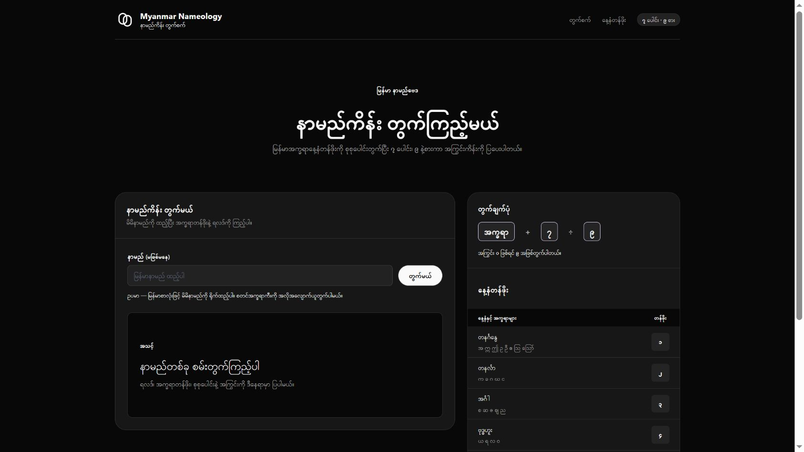

# Myanmar Namelogy (မြန်မာနာမည်ကိန်းတွက်စက်)

[Burma Project Ideas](https://github.com/burma-project-ideas) အောက်မှာ နောက်လာမယ့်သူတွေ App Flow နဲ့ Data ကို လေ့လာပြီး ကိုယ်နှစ်သက်တဲ့ Programming Language နဲ့ ပြန်ရေးကြည့်နိုင်ဖို့ ထားပေးထားတဲ့ Project ပါ။ Organization ဆီ ပြောင်းရွှေ့ထားခြင်းက မူရင်း Creator နဲ့ Data Source Credit ကို အစားထိုးခြင်း မဟုတ်ပါဘူး။

[App ကို ဒီမှာ ဖွင့်နိုင်ပါတယ်](https://myanmar-nameology.vercel.app/)။ 2026-11-08 မှာ Live Calculator နဲ့ Published Framework Assets ကို စစ်ဆေးထားပါတယ်။ Repository အမည်ပြောင်းပေမယ့် Live Domain ကို မပြောင်းထားပါဘူး။

မြန်မာနာမည်ကိန်းတွက်စက်ကို Blazor WebAssembly နဲ့ တည်ဆောက်ထားတဲ့ compact web app ဖြစ်ပါတယ်။ နာမည်ထည့်ပြီး မြန်မာအက္ခရာနေ့နံတန်ဖိုးကို တွက်ကာ `၇ ပေါင်း`၊ `၉ နဲ့စား` ပြီး အကြွင်းကိန်းအလိုက် ရလဒ်အဓိပ္ပာယ်ကို ပြပေးပါတယ်။

> ဒီ project က မြန်မာ့ရိုးရာ အမည်ဗေဒင်ယုံကြည်မှုအပေါ် အခြေခံထားတဲ့ entertainment calculator ဖြစ်ပြီး သိပ္ပံနည်းကျ အတည်ပြုထားတဲ့ တွက်ချက်နည်းမဟုတ်ပါ။

## Project Overview

- Framework: Blazor WebAssembly standalone
- Target: .NET 10 (`net10.0`)
- App route: `/`
- Main UI: `MyanmarNameology/Pages/Home.razor`
- Calculator logic: `MyanmarNameology/Services/NameologyCalculator.cs`
- Result models: `MyanmarNameology/Models/NameologyResult.cs`
- Main icon/logo: `MyanmarNameology/wwwroot/logo.svg`

ဒီ app ရဲ့ landing page က marketing page မဟုတ်ဘဲ calculator ကိုပဲ ပထမဆုံး screen အနေနဲ့ သုံးနိုင်အောင် ဖန်တီးထားပါတယ်။ Name input, calculate action, live result area, formula summary, နေ့နံတန်ဖိုး table တွေကို responsive layout နဲ့ ပြထားပါတယ်။

## Contributors

| Contributor | Contributor | Contributor | Contributor | Contributor |
| --- | --- | --- | --- | --- |
| <a href="https://github.com/sannlynnhtun-coding"><br>sannlynnhtun-coding</a> | <a href="https://github.com/theinhtetaung-dev"><br>theinhtetaung-dev</a> | <a href="https://github.com/phonewinttun-dev"><br>phonewinttun-dev</a> | <a href="https://github.com/hlaingmyoaungdeveloper"><br>hlaingmyoaungdeveloper</a> | <a href="https://github.com/thirilinn-dev"><br>thirilinn-dev</a> |

## App ရဲ့ Workflow

1. User က မြန်မာနာမည်ကို input box ထဲမှာ ရိုက်ထည့်သည်။
2. `တွက်မယ်` ခလုတ်ကို နှိပ်သည့်အခါ (သို့) form ကို submit လုပ်သည့်အခါ `Home.razor` က `NameologyCalculator.Calculate(...)` ကို ခေါ်သည်။
3. Calculator က နာမည်ထဲက တွက်နိုင်တဲ့ မြန်မာအက္ခရာများကို ရွေးထုတ်သည်။
4. အသတ်နဲ့ဆုံးတဲ့ final consonant များကို keyword ထဲမထည့်ဘဲ ကျော်ထားသည်။
5. ရွေးထုတ်ထားတဲ့ အက္ခရာများကို နေ့နံတန်ဖိုးနဲ့ map လုပ်ပြီး စုစုပေါင်းတွက်သည်။
6. စုစုပေါင်းကို `၇` ပေါင်းပြီး `၉` နဲ့စားသည်။
7. အကြွင်း `၀` ဖြစ်ရင် `၉` အဖြစ်ယူပြီး ကိန်းအဓိပ္ပာယ်ကို ပြသည်။

တွက်ချက်ပုံအကျဉ်း:

```text
အက္ခရာတန်ဖိုး စုစုပေါင်း + ၇
ရလာဒ်ကို ၉ နဲ့စား
အကြွင်းကိန်းအလိုက် အဓိပ္ပာယ်ပြ
```

## နေ့နံတန်ဖိုး Table

| နေ့နံ | တန်ခိုး | နံတန်ဖိုး |
| --- | --- | --- |
| တနင်္ဂနွေ | အ ဣ ဤ ဥ ဦ ဧ ဩ ဪ | ၁ |
| တနင်္လာ | က ခ ဂ ဃ င | ၂ |
| အင်္ဂါ | စ ဆ ဇ ဈ ည | ၃ |
| ဗုဒ္ဓဟူး | ယ ရ လ ဝ | ၄ |
| ကြာသပတေး | ပ ဖ ဗ ဘ မ | ၅ |
| သောကြာ | သ ဟ ဠ | ၆ |
| စနေ | တ ထ ဒ ဓ န | ၇ |

## အသုံးပြုနည်း

1. Website ကိုဖွင့်ပါ။
2. နာမည် input ထဲမှာ မိမိတွက်ချင်တဲ့ မြန်မာနာမည်ကို ရိုက်ထည့်ပါ။
3. Result area မှာ အမည်ကီး၊ အက္ခရာတန်ဖိုးခွဲခြမ်းချက်၊ စုစုပေါင်း၊ `၇ ပေါင်းပြီး` တန်ဖိုး၊ `၉ နဲ့စား` အကြွင်းနဲ့ ကိန်းအဓိပ္ပာယ်ကို ကြည့်နိုင်ပါတယ်။
4. မြန်မာအက္ခရာမပါသော input ဖြစ်ရင် app က တွက်လို့မရကြောင်း friendly message ပြပေးပါတယ်။
5. Empty input ဖြစ်ရင် နာမည်ထည့်ရန် prompt ပြပေးပါတယ်။

## Local မှာ Run မယ်

လိုအပ်ချက်:

- .NET 10 SDK

Restore:

```powershell
dotnet restore MyanmarNameology.slnx
```

Run local app:

```powershell
dotnet run --project MyanmarNameology --urls http://localhost:5166
```

ပြီးရင် browser မှာ ဖွင့်ပါ:

```text
http://localhost:5166/
```

Build:

```powershell
dotnet build MyanmarNameology.slnx
```

## Project ဖွဲ့စည်းပုံ

```text
MyanmarNameology/
├─ MyanmarNameology.slnx
├─ vercel.json
├─ MyanmarNameology/
│  ├─ Pages/Home.razor
│  ├─ Services/NameologyCalculator.cs
│  ├─ Models/NameologyResult.cs
│  ├─ wwwroot/index.html
│  ├─ wwwroot/logo.svg
│  └─ wwwroot/css/app.css
└─ .github/workflows/deploy-vercel.yml
```

## Build နဲ့ Deployment

GitHub Actions workflow က Vercel ကို deploy လုပ်ဖို့ ပြင်ထားပါတယ်။ Repository secrets ထဲမှာ အောက်ပါ values တွေလိုအပ်ပါတယ်။

```text
VERCEL_TOKEN
VERCEL_ORG_ID
VERCEL_PROJECT_ID
```

`main` branch ကို push လုပ်တဲ့အခါ build output ကို Vercel project သို့ deploy လုပ်နိုင်ပါတယ်။ SPA routing အတွက် `vercel.json` ထဲမှာ rewrite rule ပါဝင်ပြီး Blazor `_framework` assets တွေကို long-term cache header သတ်မှတ်ထားပါတယ်။


## အဓိက ပံ့ပိုးသူများနှင့် မူရင်း Data

မူရင်း README ရဲ့ Contributors Table ကို ဆက်လက်ထိန်းသိမ်းထားပါတယ်။ တွက်ချက်နည်းရဲ့ မူရင်းစာအုပ်/ရေးသားသူကို Repository မှာ သီးခြားမဖော်ပြထားပါဘူး။

## ကိုယ်တိုင် ပြန်ရေးကြည့်ချင်ရင်

အပေါ်က App Workflow ကို အဆင့်လိုက် လေ့လာပြီး UI၊ Data နဲ့ State ကို ခွဲရေးကြည့်နိုင်ပါတယ်။ Bug Report၊ Documentation နဲ့ Implementation အသစ်တွေကို Issue / Pull Request နဲ့ ပံ့ပိုးနိုင်ပါတယ်။ မူရင်းပံ့ပိုးသူနဲ့ Data Credit ကို ဆက်လက်ထိန်းသိမ်းပါ။

## Production Deployment Path

Production ကို `.github/workflows/deploy-vercel.yml` က .NET Publish လုပ်ပြီး `wwwroot` ကို Vercel ဆီ Deploy လုပ်ပါတယ်။ Source Repository ကို Build မလုပ်ဘဲ Publish လုပ်တဲ့ Vercel Git Auto-deploy နဲ့ ပြိုင်မဖြစ်အောင် `vercel.json` ရဲ့ `git.deploymentEnabled` ကို `false` သတ်မှတ်ထားပါတယ်။ `main` Push နဲ့ Manual Workflow Run တွေက GitHub Actions မှတစ်ဆင့် ဆက် Deploy လုပ်ပါတယ်။ Live URL က [myanmar-nameology.vercel.app](https://myanmar-nameology.vercel.app/) ပါ။

## UI Design Update

The interface follows [Bencho](https://bencho.dev/)'s dark visual direction: a black canvas, charcoal panels, white pill actions, compact headings, and restrained interaction feedback. The app stays in Blazor with native controls and a locally compiled Tailwind CSS stylesheet. No React component package, Bootstrap, Radzen, Font Awesome, or runtime Tailwind CDN is required.

Application data and calculation/storage behavior are preserved. The Myanmar Padauk font and its license remain included. Keyboard focus, responsive reflow, and reduced-motion preferences are supported.

After changing styles or utility classes, run `npm ci` and `npm run build:css` before the .NET publish command. Generated CSS is committed so existing static deployment workflows remain compatible.



[Mobile preview](screenshots/redesign-mobile.jpg)

## Brand assets

The original monochrome mark matches the dark interface. Transparent SVG/PNG masters, a dark-on-light variant, favicon sizes (16/32/48), Apple touch icon (180), app icons (192/512), and a 1200×630 social image are generated from `wwwroot/branding/logo-master.svg`. Run `npm ci && npm run build:brand` to regenerate them. Existing font and data licenses remain unchanged.
